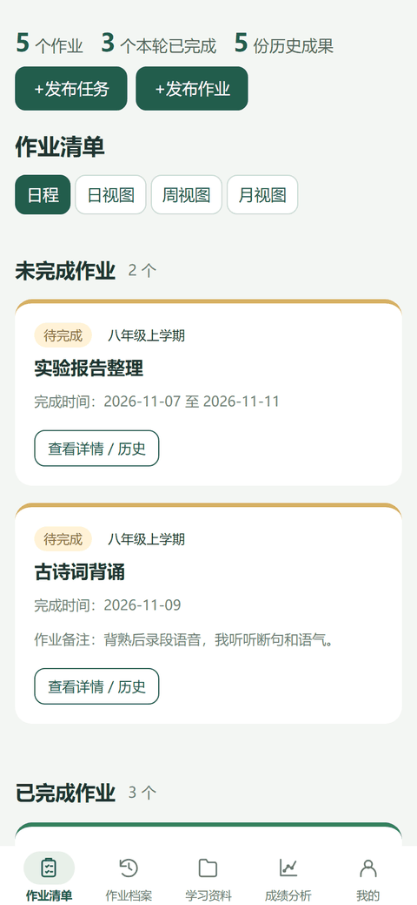

<h1 align="center">伴学记录</h1>

<p align="center">
  <a href="https://github.com/wang189327-wq/accompany-learning/actions/workflows/ci.yml"></a>
  <a href="package.json"></a>
  <a href="LICENSE"></a>
  <a href="https://github.com/wang189327-wq/accompany-learning/releases/latest"></a>
  <a href="https://wang189327-wq.github.io/accompany-learning/demo/"></a>
</p>

<p align="center">面向互相信任的老师与学生两人的作业管理与学习记录工具，支持安卓手机、安卓平板和网页。任务、作业、学习资料与考试记录通过自己部署的云端同步。</p>

<p align="center">
  
</p>

<p align="center"><sub>动图录制自<a href="https://wang189327-wq.github.io/accompany-learning/demo/">在线演示</a>，使用示例数据（只保存在本机浏览器），不含任何真实学生信息。</sub></p>

## 为什么做这个

两个人的教学里，作业往往散在聊天记录、纸质本和几张临时表格里：谁交了、批没批、上周做到哪、这次比上次进步没有，隔几天就说不清。一对一辅导和家教场景尤其如此 —— 课时短、频次高、回头追溯的需求强。

这类场景不需要一套教务系统，也不需要多租户后台，只需要一处随时翻得回去的记录。伴学记录就是按这个前提长的：两个人、一个访问码、自己的云存储，不引入多余的账号体系。

## 能做什么

- 发布任务（仅名称必填，学科、学期选填），一项任务关联多份作业；作业也可保持未关联。
- 单次及每日/每周/每月作业，日期与完成星期、授课、停用和暂停当前周期。
- 文字、图片、文件和默认打卡；周期作业反复提交、补交和作业档案。
- 学生自评分、老师评分、评分趋势、作业备注与周期备注；界面显示日期而非轮次编码。
- 日程、日/周/月视图、双方独立作业排序、安卓桌面小组件。
- 学习资料与试卷文件夹、多学期和学科筛选、图片/DOCX/PDF 查看及缩放。
- 考试成绩、班级/年级排名、不同满分换算和趋势分析。
- 分角色头像昵称，共同学习目标和可编辑录取表格、字号与背景颜色。
- 应用内消息与提醒；可选的电脑 OpenClaw 作业图片点评。

## 使用范围与边界

**适用：**互相认识、共享同一个访问码的老师与学生两人。

**角色是界面模式，不是权限。**持有同一访问码的人都可以切换老师和学生身份，因此老师专属操作只起防误触作用，不构成对内的越权隔离。当前没有独立用户账号、多租户隔离或应用外推送服务；提醒在同步时生成，不保证关闭软件后实时触发。

**数据自己保管。**文件存进你创建的私有 OSS，元数据存进你的 Tablestore，作者不持有任何实例，也无法访问你的记录。相应地，备份与容量管理由你负责。

## 下载安装

[最新发布](https://github.com/wang189327-wq/accompany-learning/releases/latest) 提供 APK、云端部署包与源码：

| 内容                    | 用途                               |
| ----------------------- | ---------------------------------- |
| `伴学记录-v1.0.apk`     | 安卓手机、平板客户端               |
| 云端接口包、云端界面包  | 部署到你自己的阿里云函数与静态托管 |
| 源码（对应 tag 的 ZIP） | 自行构建、修改，或用于本机演示     |

APK 只是客户端，**不包含任何云端地址或访问码**。装完必须按下文准备自己的云端，否则只能停在连接页 —— 这是公开版的有意设计，仓库里不放作者的服务器信息。

当前显示版本 1.0、安卓内部版本 1、云端接口 build 1（协议 1.6.0）。此公开版不包含作者服务器地址、访问码、用户数据或安卓签名私钥。

## 直接体验

不想装任何东西，可以打开[在线演示](https://wang189327-wq.github.io/accompany-learning/demo/)：五个页面都能点，改分数、交作业、切换角色都行，数据是预置的示例，改动只留在你自己的浏览器里。演示不连云端，也不保存任何内容。

演示页不是另做的一套界面，而是由 `scripts/build-demo.cjs` 从根目录 `index.html` 生成、再由 `demo/demo-boot.js` 写入示例数据后启动的同一份代码。`demo/index.html` 是生成结果，改界面请改根目录那份。

## 本机先看看

安装 Node.js 22 或更新的受支持版本，以及 Git，在仓库根目录运行：

```sh
npm ci
npm ci --prefix cloud --ignore-scripts
npm run dev
```

打开终端显示的本机地址，填入本次临时访问码，选择角色。演示使用内存存储，停止程序后清空；正式使用需要部署云端。不要上传重要作业作为唯一保存副本。

## 正式部署

按顺序阅读：

1. [阿里云部署教程](docs/DEPLOY_ALIYUN.md)：主函数、两张表、私有OSS、权限、环境变量、可选备份函数。
2. [网页部署和安卓更新](docs/DEPLOY_WEB.md)：Netlify发布目录、自建更新源、APK元数据。
3. [安卓构建](docs/BUILD_ANDROID.md)：Windows工具、签名、接口与更新地址配置。
4. [可选AI点评](docs/AI_REVIEW.md)：电脑服务、OpenClaw、独立凭据与离线行为。
5. [函数和API清单](docs/FUNCTIONS.md)：每个部署组件、代码入口及接口用途。

仅需要一个主接口函数。自动备份函数和电脑AI点评服务均可选；资料、评分与任务同步不要求启用AI。

## 存储与容量

容量达到 1GB 时仅在界面提醒，不限制上传数量，也不自动删除已完成附件；未完成的上传分片可设置 3 天自动清理。两项都需要在云端额外授权与配置，打包本身不会修改任何云资源 —— 具体见[存储维护与告警](docs/STORAGE_MAINTENANCE.md)。

## 常见问题

**装不上 APK，或提示签名冲突。** 不同签名打包的 APK 不能互相覆盖安装。先确认云端记录正常，再卸载旧版安装新版；卸载只会清掉本机的界面缓存与已下载附件，云端数据不受影响。

**填了地址和访问码，仍提示连接失败。** 依次检查三处：接口地址是否为函数的实际地址（正式环境须为 HTTPS，且不带路径、端口或参数）；函数环境变量 `C9_ALLOWED_ORIGINS` 是否包含网页所在域名；访问码是否与函数里的 `C9_ACCESS_TOKEN` 完全一致。

**访问码忘了怎么办。** 访问码是你部署时自己写进 `C9_ACCESS_TOKEN` 的值，仓库里没有默认值，也没有找回入口。重新设置环境变量后，在连接页重填即可，已有数据不受影响。

**提醒为什么没有马上响。** 提醒在同步时生成，不依赖系统推送；软件关闭或长期不打开时不会有实时通知。这是当前设计，不是配置错误。

**能不能多人或一个班使用。** 当前不支持。没有账号体系与数据隔离，所有人共享同一份数据与老师权限。这类需求应改用带账号的完整系统。

## 构建与检查

通过 ZIP 下载源码时先执行 `git init`，供格式及公开内容检查列出项目文件；通过 `git clone` 取得的仓库无需这一步。

```sh
npm run format:check
npm test
npm run check:public
npm run package:cloud
```

云端 ZIP 生成在 `cloud/release/`；包含运行依赖和网页。不要把整个 Git 仓库作为函数代码上传。`npm test` 使用合成数据及本机服务，不修改真实云端或调用真实模型。安卓 APK 资源检查需先构建，再运行 `npm run test:apk`。

GitHub Actions 在 Windows/Linux 上运行源码检查、自动化测试和云端打包。CI 不会部署你的服务器，也不会使用签名或云端凭据。

## 目录

| 路径                             | 作用                                       |
| -------------------------------- | ------------------------------------------ |
| 根目录 JS、HTML、CSS             | 界面、业务模型、预览及主题                 |
| `cloud/`                         | 主接口、存储适配、快照优化、部署打包       |
| `android/`                       | 安卓 WebView、文件保存、安装更新和桌面组件 |
| `desktop-review/`                | 可选电脑 AI 点评服务                       |
| `scripts/`                       | 配置、测试、演示、网页及更新文件生成       |
| `docs/`                          | 当前部署与维护教程、界面截图、演示动图     |
| `deploy/`                        | 网页部署模板                               |
| `third-party-notices/`、`pdf-*/` | 第三方预览组件的授权及资源                 |

新增的 `build/` 集中维护平台脚本清单、HTML 命名区域，以及网页和安卓资源的构建过程。

## 第一次阅读源码

前端没有模块打包器：浏览器按`build/assets.cjs`列出的顺序加载经典脚本，部分页面状态通过`globalThis`共享。这样可以直接生成网页和安卓WebView资源，但也意味着新增或移动脚本时，必须同步构建清单、HTML引用和平台资源映射。云端使用Node.js模块，并有自己的运行依赖；“前端无打包依赖”不等于整个项目没有依赖。

建议按这个顺序熟悉代码：

1. 从`index.html`和`app.js`看页面入口、事件处理和状态协调。
2. 再看`task-views.js`、`library-views.js`、`study-ui.js`等功能模块；修改目标不明确时，先查[修改位置导航](docs/DEVELOPMENT.md)。
3. 涉及跨端资源时看`build/assets.cjs`、`build/asset-manifest.cjs`和[架构与调用流程](docs/ARCHITECTURE.md)，不要直接改生成后的`cloud/public/`或`android/build/`。
4. 修改云端行为时沿`cloud/server.cjs`路由进入`cloud/core.cjs`或`cloud/task-service.cjs`，存储细节在`cloud/aliyun.cjs`；部署包文件还需登记在`cloud/package.cjs`。

根目录保留了多个浏览器入口脚本，文件数较多是按浏览器直接加载和多端共用资源形成的组织方式。新文件优先放入`build/`、`cloud/`、`android/`、`scripts/`或`tests/`等已有目录；只有浏览器直接加载的功能模块才放根目录，并同时登记到构建清单。开始修改前读对应流程文档，完成后按改动范围运行测试与构建。

## 升级与兼容

从旧版本升级到 1.0 时，既有作业和成果全部保留，旧作业默认未关联任务。作业发布与作业档案的任务选择支持输入关键词后点选，同名任务可用已填写的学科、学期区分。任务选填功能须部署本版 build 1 接口，原表、环境变量和存储继续使用；完整说明见[1.0 发布与部署说明](docs/UPGRADE_4.md)。

为兼容既有数据，包名 `cn.c9.studyplan`、部分内部 C9 标识和环境变量名保留。自行构建者应保管自己的签名；不同签名的 APK 不能互相覆盖安装。

GitHub 仓库和本地工程目录名为 `accompany-learning`，软件显示名为“伴学记录”；自用 C9 版本从同一份源码派生，差异仅为显示名称。[名称、目录与构建对应说明](docs/PROJECT_MAP.md)。

## 参与改进

当前比功能建议更有用的三类帮助：

1. **实体设备安装反馈** —— CI 覆盖 Windows/Linux 与模拟器检查，真机安装验收仍在进行中，见[验证记录](docs/VALIDATION.md)。遇到厂家 WebView 差异请附机型与系统版本。
2. **界面截图** —— 不同浏览器与 WebView 对 DOCX/PDF 预览、缩放的渲染差异较大，实际截图比文字描述更容易定位问题。
3. **文档纠错** —— 部署步骤里走不通、说不清的地方，直接提 Issue 说明卡在第几步、报什么错。

修改代码请先读[贡献指南](CONTRIBUTING.md)，架构与调用流程见[架构说明](docs/ARCHITECTURE.md)、[修改位置导航](docs/DEVELOPMENT.md)和[数据结构与关键规则](docs/DATA_MODEL.md)。自有代码统一格式，第三方分发和冻结兼容夹具保持原样。

## 数据与授权

用户文件保存在自己的私有 OSS，元数据在自己的 Tablestore；公开此仓库不会上传这些数据。普通删除任务保留历史成果，学生端隐藏已删任务，老师端仍可查看。备份索引依赖原始附件，不应把删除整个 Bucket 视为普通任务删除。

主项目采用 [MIT 许可](LICENSE)。PDF.js、docx-preview、JSZip 及字体资源继续按各自授权分发，见[第三方组件说明](docs/THIRD_PARTY.md)。报告问题前请阅读[安全说明](SECURITY.md)，不要在 Issue 中粘贴访问码或真实学生作业。
