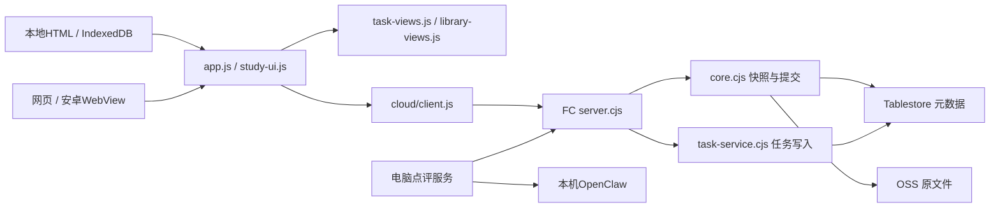
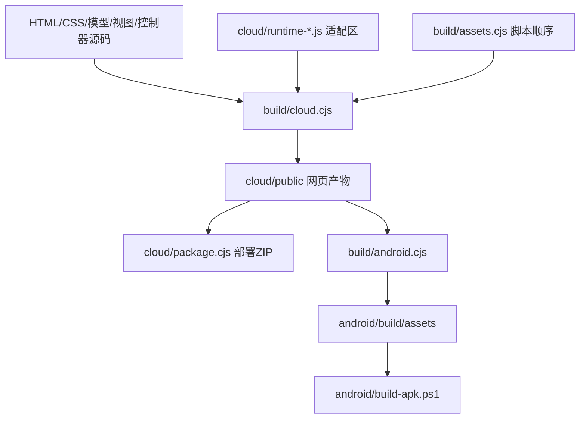

# 架构与调用流程

## 运行位置

同一套业务模型服务本地演示、网页、安卓和云端。本地存储与云端接口通过构建时的明确适配区切换；不会在运行时把本地数据自动迁移到云端。

## 前端职责

| 文件                               | 负责什么                                         | 不应放入什么         |
| ---------------------------------- | ------------------------------------------------ | -------------------- |
| `app.js`                           | 主状态、刷新、事件路由、详情/提交/评分与页面协调 | 新的庞大页面模板     |
| `task-views.js`                    | 任务卡片、日程/日周月及历史HTML                  | 上传、数据库写入     |
| `study-ui.js`                      | 资料/试卷筛选状态、编辑表单、上传及事件          | 新的完整列表模板     |
| `library-views.js`                 | 资料列表、目录、试卷页与筛选栏HTML               | 云端请求和持久存储   |
| `my-page.js`                       | 个人信息、目标、表格和消息界面                   | 任务周期算法         |
| `model.js`                         | 周期、状态、提交、评分、日历规则                 | DOM和网络请求        |
| `study-model.js` / `my-model.js`   | 资料/成绩、目标/表格/提醒规则                    | 设备文件操作         |
| `file-viewer.js` / `image-zoom.js` | 只读预览、缩放、资源清理                         | 修改作业或试卷元数据 |

`TaskViews.create(getContext)`与`LibraryViews.create(getContext)`在每次渲染时取最新状态，避免捕获过期角色、筛选或轮次。模块不拥有控制器数据。为兼容原规则，资料视图遇到已不存在的当前目录时仍会将该筛选恢复到根目录。

较长的HTML按元素分成字符串片段，最后用`join('')`连接，便于定位修改，同时保持原输出中的空格和转义。用户输入继续先经过原转义函数；不要为了缩短模板去掉它们。

部分控制器仍使用经典脚本的共享变量。这次整理没有引入新框架，也没有把所有事件改成新的状态系统；后续拆分应从独立行为开始，避免一次改动整套页面生命周期。

## 一次作业提交

1. 控制器创建本次 `requestId`，读取当前任务版本和轮次。
2. `cloud/client.js`分段上传附件。网络重试复用本次会话，不重新生成提交身份。
3. `/api/submissions`校验角色、形式、评分、任务版本与轮次。
4. 原始内容进入OSS；任务上的`_rounds`引用用条件写入登记。
5. 客户端同步快照，双方读取提交、评分和点评。

只有服务器确定完成时间和补交状态。请求重试、周期再次补交、老师评分是不同操作，不要共用它们的版本号。

## 后台边界

`server.cjs`做路由和鉴权；`task-service.cjs`做发布/修改、星期、备注、暂停与顺序写入；`core.cjs`继续负责上传、提交、评分、快照、历史恢复及备份；`extras.cjs`管理个人设置与消息；AI领取/回传规则在两个AI模块中。

`createTaskService(dependencies)`注入原存储、时钟、校验和事件函数，使用同一套条件写入规则。不要在子模块创建另一个时钟或绕过任务版本检查。

## 构建

- 旧CLI入口`cloud/build.cjs`和`android/prepare-assets.cjs`保留，具体工作交给`build/`。
- HTML用命名区域填充样式、连接框、脚本和启动文字；缺失或重复区域会停止构建。
- `cloud/runtime-builder.cjs`只替换明确标记的JS适配区，不按函数必须写在一行的正则改代码。
- 图片下载通过`download()`明确调用现有安卓桥接或浏览器保存，异步失败由原事件处理器接住。
- 根目录`styles.css`是共享样式源；安卓追加`android/styles.css`。HTML源文件链接CSS，生成网页/APK内嵌样式。
